## AWS Cloud Engineer

**Greetings! We'll be going over the tasks for Tech Challenge 2 of the Cloud Engineering program. Lets get started!**

## Tech Challenge 2 - Action Steps

* Phase 1: Run the app locally in a container
* Phase 2: Terraform the AWS environment
* Phase 3: EKS cluster setup and add-ons
* Phase 4: Manual Flask Deployment with Helm
* Phase 5: Jenkins CI/CD Automation
* Phase 6: HPA and Node Autoscaler Load Tests
* Phase 7: GitOps with GitHub Actions and ArgoCD

________________________

## Tech Challenge Overview

Welcome to Tech Challenge 2! The overall goal for this challenge is to deploy a Python Flask application automatically using a CI/CD pipeline. The initial pipeline will use a Jenkins server to deploy a custom Python image built by Kubernetes (K8s) from a Helm chart. Since we'll be implementing a metrics server and an AWS Load Balancer Controller, we'll conduct a load test as well on the application to demonstrate automatic scaling in K8s. Lastly, we'll remove the Jenkins server and run the same pipeline utilizing webhooks via GitHub Actions and use Argo CD to make sure our K8s application deployment always matches the desired state defined in our GitHub repo. 

Lets do this!

## Phase 1: Run the app locally in a container

We'll start Tech Challenge 2 (TC2) the same way as we started Tech Challenge 1 (TC1) by locally testing our application to verify it functions appropriately. TC2 asks for a simple "Hello, World!" Python Flask app so I went online and grabbed some code from medium.com article. We modified the code so it will utilize a web browser on port 5000 to showcase the message. I decided to later change the message to "Hello (cruel), World!" just for fun. 

 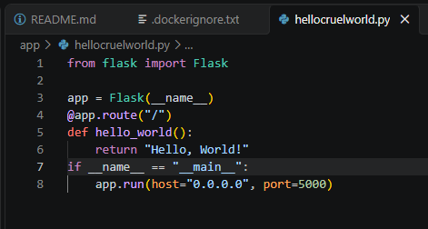

Lets make sure the Python script works. I logged into my EC2 instance and created a Python virtual environment in order to run my script. Use the command `python3 <script_name>` in order to run your script. In this first terminal, you'll see the script begin and show that's it's listening on the specified port. You can also use `ss -tunlpe` to make sure the app is running on the proper port.  

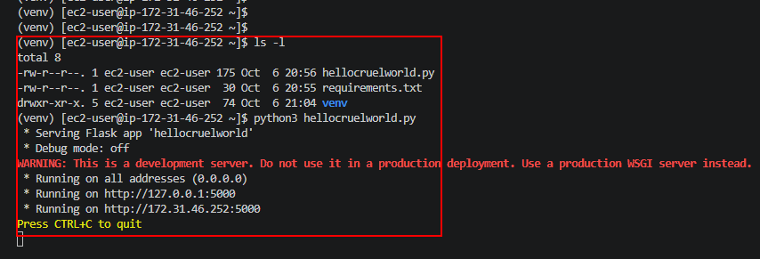

In a second terminal onthe EC2 instance, perform a curl test on the local machine using `curl -i http://localhost:5000` to received the success message.

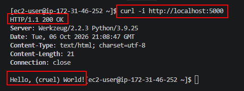

If you go back to the first termainl, you'll also see the GET request posted to your script. That verifies that the script is functioning as intended!

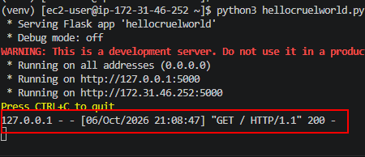

Now, lets containerize our application using Docker. Install Docker and make sure the service has started. 

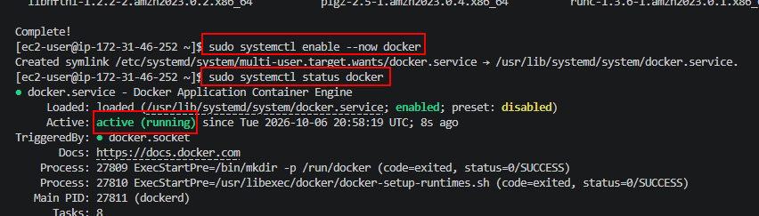

Now, we need to package our Python script and the required packages all in one Dockerfile so we can create an image and run a container from this image. In a previous Python lab, I ran a similar script and created the requirements.txt file so I'll be reusing those with the Dockerfile. You can use my Dockerfile in my repo. Once you run the `docker build` command, your image will be built. Start your container using the `docker run` command and check to see if the container is running by using the `docker ps` command. We can use `docker log tc2-hello-world` to verify the container is listening on the right port.

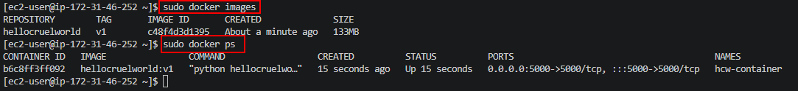

Now, our final test for Phase 1 will be making sure the container displays the success message as well. Use the same curl test to make sure we receive the proper output. This time, we don't need to open a second window since the script is being ran inside the container. You should receive "Hello (cruel), World!" in your terminal output!

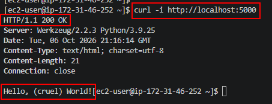

Lets push our Dockerfile and required script files to our GitHub repository (repo) so we can use them later on for our pipelines. You can use the sequence of `git add .`, `git commit -m "<insert_message>"`, and `git push origin main` to accomplish this. 

Now, lets terraform our infrastructure so that we can run all of this in the cloud. 

## Phase 2: Terraform the AWS environment

We need to make sure our entire AWS environment can automatically be deployed to support our application. We'll use Infrastructure as Code (IaC) via Terraform (TF) to deploy our environment. Now, in Project 2, we already created an Elastic Kubernetes Service (EKS) resource that included a cluster and worker node group so I'm overall familiar with this TF block. The difference this time was we would later create the AWS Load Balancer Controller within EKS so this is not a resource block that needed to be added. 

In TC1, we also created two different Elastic Container Registry repos so I borrowed from that code to create our one and only `hello-cruel-world-repo` repo. The networking.tf and jenkins.tf files pretty much stayed the same from the previous challenge. Just a reminder, the Jenkins server, NAT Gateway, and ALB will go in the public subnets. The EKS worker nodes and application pods will go in the private subnets. We added AWS DNS support in our VPC block. We did, however, update the providers.tf file to include [I honestly forget]. 

Another weird piece was allowing the AWS Load Balancer Controller to figure out which subnets it could use. We placed this information in the tag section of the subnets. I've never seen that before. Apparently the Kubernetes tag tells the controller that you can use this for the AWS load balancer.

Now, I straight up asked AI to create the iam.tf file because I simply don't want to deal with AWS IAM. Once again, I have an Azure background and I'm not used to handling this. I'll focus on it at a later time.

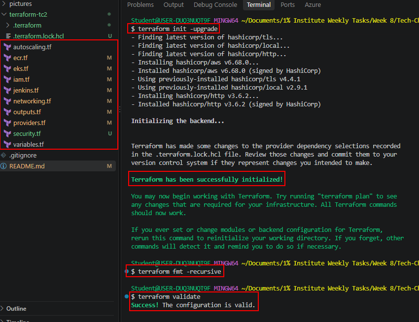

I actually deployed the resources file by file until I had everything working properly. I used this approach because I didn't want to create 8 TF files and have to troubleshoot which ones didn't work because some of these resources depend on other resources. So I asked AI to categorize the TF files based on which ones I should design first. There was a lot of terraform apply and destroy until we arrived to the very end. 

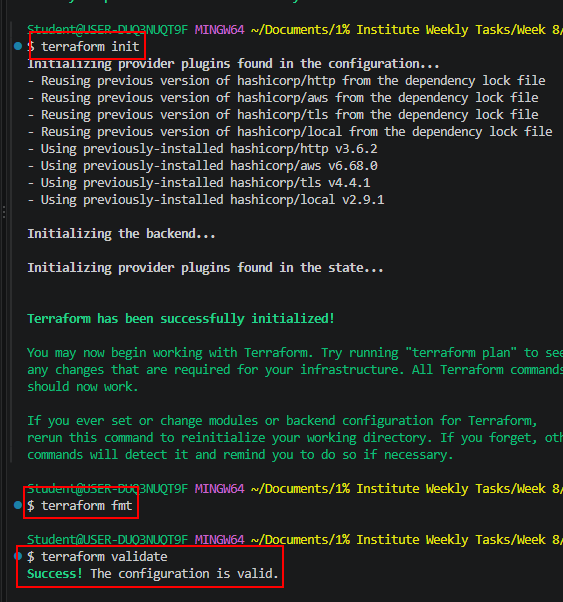

The final deployment created 44 resources for us. Now our AWS environment is ready to be used to deploy our application. 

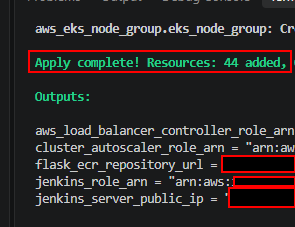

There were a few modifications post-apply that were added but they should be included in the final TF code inside the repo. Lets move to Phase 3. 

## Phase 3: EKS cluster setup and add-ons

This phase was extremely command heavy. Overall, we basically needed to set up the Jenkins server EC2 instance to be able to run all of our operations. We needed to install the CLI for AWS, Git, Docker, kubectl, and Helm. I've included the commands to install all of these tools. In the future, I may create an Ansible playbook for this entire section and just run it. 

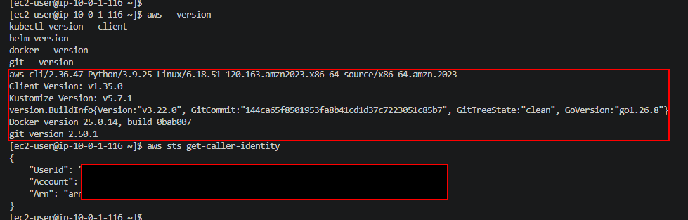

We can verify that our K8s pods are running using the `kubectl get pods` command. Since we haven't deployed any specific resources yet, the only namespace we should be using is the `kube-system` namespace since that's where our control plane resources are located. 

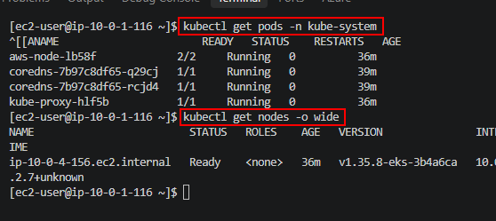

Now, we need to install a Metrics server, AWS Load Balancer Controller, and Autoscaler. These resources have their own Helm repos that outline the required files and values to create said resources. Lets install the metrics server using the `kubectl apply -f` command followed by the appropriate GitHub URL. Once again, all of these commands are listed in my `notes/Commands-For-TC2.txt`. Use the commands `kubectl rollout` and `kubectl get deployment/metrics-server -n kube-system` to verify that the deployment rollout was successful and that the metrics server is running. Now, when you use the `kubectl get pods/nodes`, you'll see the percentages for the resources that are being utilized.  

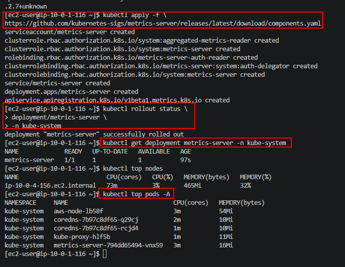

Now, lets get our AWS Load Balancer Controller running. This resource lives in the AWS EKS Helm repo. The controller creates and manages the ALB for K8s. It watches the Ingress and Service for K8s and creates the ELB resources for our deployment. We needed to pull from that Helm repo, create a service account annotations, update the repo, and then use Helm install to create the deployment. 

We needed to create the service account because since the controller is a Pod running inside of K8s, it needs permissions to do things outside of K8s. Since this load balancer is talking to API endpoints, AWS isn't just going to let the LB pod execute that. So we created the service account and then used the annotation to associate the service account with our controller. There's an OIDC part to this as well but don't ask me about that. 

We'll use the usual `kubectl get deployment/pods` command to verify our AWS LBC is running. Remember to include the name of the deployment and the namespace. So far, we're only using the kube-system namespace. 

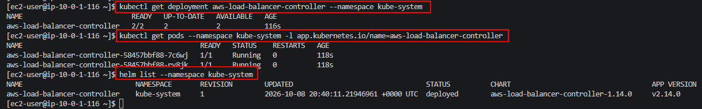

Last but not least, lets configure out Cluster Autoscaler as well. THe purpose of our Cluster Autoscaler is to scale nodes, not pods. HPA is for pods. HPA will adjust the Pod replicas based on metric usage. The Cluster Autoscaler, on the otherhand, will scale the nodes based on the Pod's hardware requirements. For example, you may have a node that's a t3.micro that only has a certain amount of CPU. If your new deployment has a Pod required resource of some specific but high amount of CPU and it requires 4 Pods, your node may not be able to support those 4 pods so the pods will go into a Pending state until the new nodes are spun up. 

This is not based on hardware USAGE. It's based on hardware REQUIREMENTS. Even if the pods don't use those resources, they're still requesting it so the nodes have to accommodate this request. The Cluster Autoscaler does this automatically based on our specifications. 

The installation process for the Cluster Autoscaler is pretty much the same as the AWS LBC except we use a different Helm repo and deployment name of course. The validation checks are exactly the same though. 

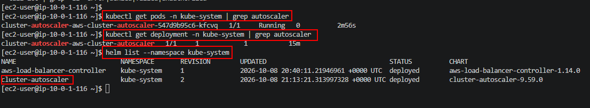

Now lets do one final verification check. Run the `kubectl get` commands for the pods, nodes, and deployments to make sure we see our critical resources in our `kube-system` namespace. 

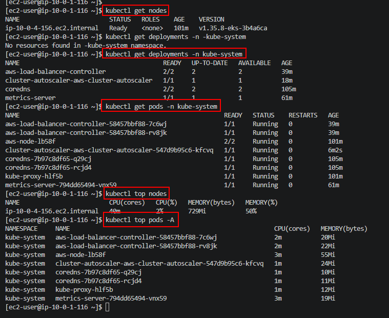

That finishes Phase 3! I have more detailed notes regarding the issues I ran into during all of these phases. Check my `notes/PersonalNotes.txt` file in my repo. 

## Phase 4: Manual Flask Deployment with Helm

For Phase 4, we wanted to make sure that our K8s environment can run our Flask Python app. We need to always test manually before we add any type of automation such as a Jenkins CI/CD pipeline. So, we'll create our image, push it to our Elastic Container Registry (ECR), create a Helm deployment, and have the deployment use our image to run our application among the Pods. 

First, clone our repo so we can have all of the necessary files. Use `docker build` to create our image with an appropriate tag from our Dockerfile. I've included the commands to use our AWS credentials with Docker to log into our ECR to push this image to our ECR repo. I actually ran into an issue not including `sudo` in the docker login command and then later in this project, ran into the reverse issue by including `sudo` in the Jenkins pipeline. Computers are smart and dumb at the same time. 

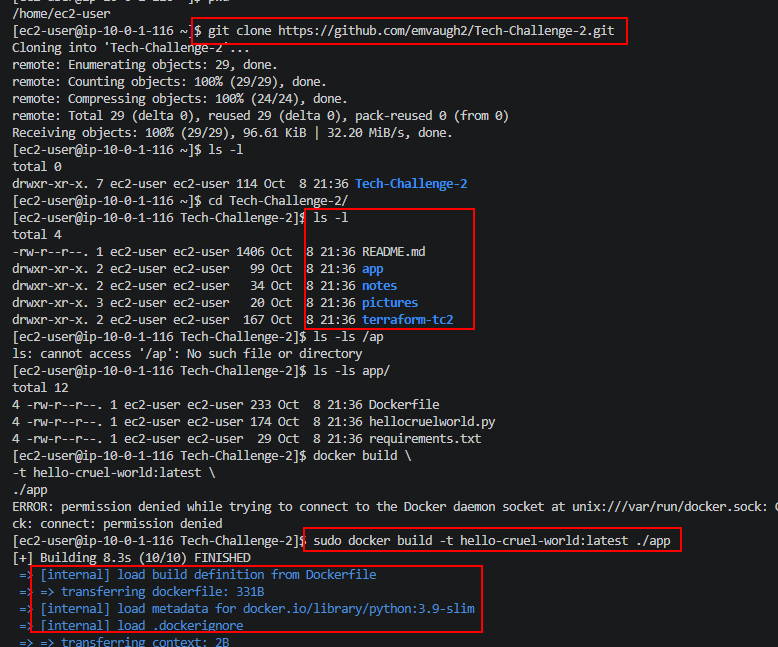

After we've pushed out image to our ECR repo, we can verify that AWS can see our image with the appropriate tag directly from the CLI. 

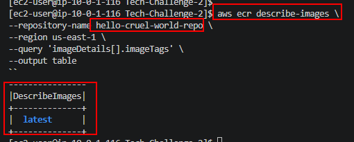

Lets create a namespace that is separate from our `kube-sytem` deployments. I named my namespace `tc2`. Create the helm directory and then use `helm create` to create our hello-cruel-world Helm chart tree in the tc2 namespace. My deployment was complaining a bit so I removed the NOTES.txt file and the httproute.yaml files. They were unnecessary. We updated our values.yaml file with all the required values in the TC2 documentation. I ran into some deployment issues because I didn't remove the `{}` brackets from some of the blocks I updated with actual values. Also, we updated the basic values in our Chart.yaml file for the right type and versions. 

As far as the values.yaml file, I'll just comment that we pointed our image to our ECR repo URI. The tag field always gets updated based on the Git push SHA number so it always keeps a fresh image tag. Yes, it doesn't visually make intuitive sense chronologically speaking but it works for the purpose of this lab. I also needed to include all of our LBC information under the `ingress:` section so that was new to me. We completely removed the HTTPRoute section. We defined out hardware request and limits for our pods and both of our Probes section (which caused a later issue in Argo CD). 

We defined our Pod autoscaling in the autoscaling section that will drive values to the hpa.yaml file. No volumes were used in this deployment. We used `helm lint` to check for Helm syntax issues and that completed our K8s configuration. 

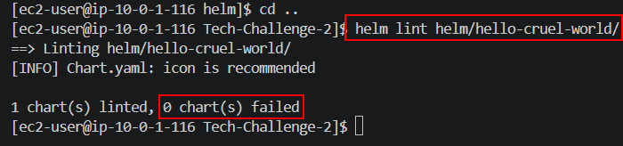

Once we fixed the port issue that the service.yaml file was incorrectly pointing to, we launched our deployment which we can check using the usual verification commands (once again, `kubectl get deployment` with the appropriate deployment name and namespace). 

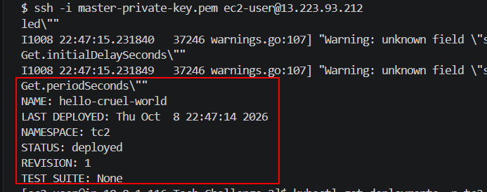

Lets make sure our application is running after all of that. Use `kubectl get svc` to get the URL endpoint. Paste that into your web browser and we should get our success message. 

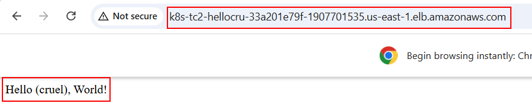

Nice! We just verified that our EC2 instance is working appropriately with our K8s cluster to deployment our application using Helm charts. 

Push all of these files up to your repo so we can use them in our CI/CD process. Lets automate this in a Jenkins pipeline. 

## Phase 5: Jenkins CI/CD Automation

In Phase 5, we'll be automating the entire previous process using a Jenkins CI/CD pipeline with a webhook. When we update any of our files in our GitHub, it will trigger this webhook to run the pipeline which will basically just update our application. We'll demonstrate this by only updating the image tag. That's enough for a showcase. Before we automate this experience, we'll make sure we can manually complete this. 

The overall process is the CI/CD pipeline will build the images using Docker, push to the ECR, then deploy to EKS using Helm and verify everything using kubectl. I've done a few Jenkins pipelines before so I'll pull from those files. We're going to create a custom Jenkins container as well. Why? Because this server will be using Docker for the image creation which will need to work with our host EC2's docker service and daemon. So, I'm going to update my custom Jenkin's Dockerfile to include all of the tools we need for our operations (Git, kubectl, helm, etc). You can find this Dockerfile in my repo. 

Now, Copilot suggested I use a Docker Compose file for my Jenkins container deployment to lessen the large command you have to use for the mount bind, port bind, container name, etc. While this was a great idea, it was horrible to implement at first because I need to install Docker Compose and Docker Buildx to get this thing running which was a BUNCH of commands I didn't want to deal with. All of those commands and verification checks are in my notes. 

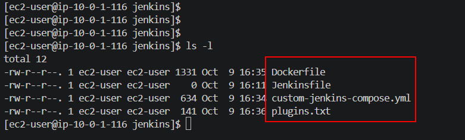

After an hour of dealing with that, I was able to get my Jenkins server up and running. 

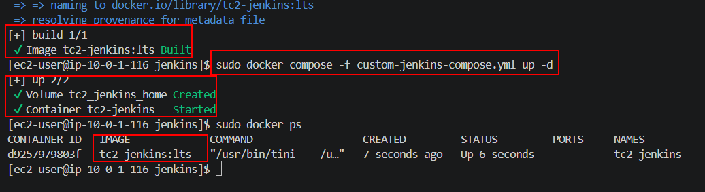

Now, follow the commands in my notes to get the Jenkins initial password, additional user account, plugin installs, and pipeline verification checks. We verified A LOT of different tools for Jenkins. Among them were an AWS CLI test, docker, kubectl, helm, etc. It's good to get these things out of the way first because you don't want to create an entire pipeline and then you realize one of your tools doesn't even work in your server. I inlcuded all of the verification pipelines in my notes. 

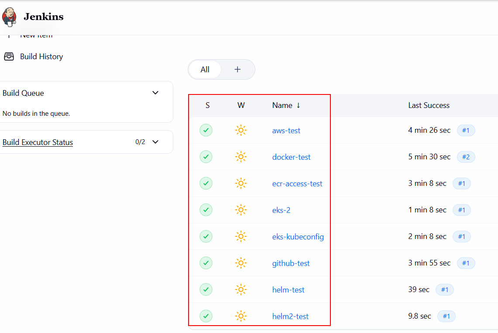

After that, we created the actual pipeline we'll be using for our deployment. Now, I asked AI to give me a general overview of each stage we would need to create for this. I tried my best to come up with the commands myself. I didn't even try with the environment variables (I'm just not used to working with those in general) and then I had Copilot correct my commands. I give myself a 60% out of 100% for this. E for effort. Copilot decided to add some strong verification checks afterwards that I would not have been able to write myself which, funny enough, the final check had a syntax error which led to the Jenkins job being a failure but the application still deployed. I fixed the issue. 

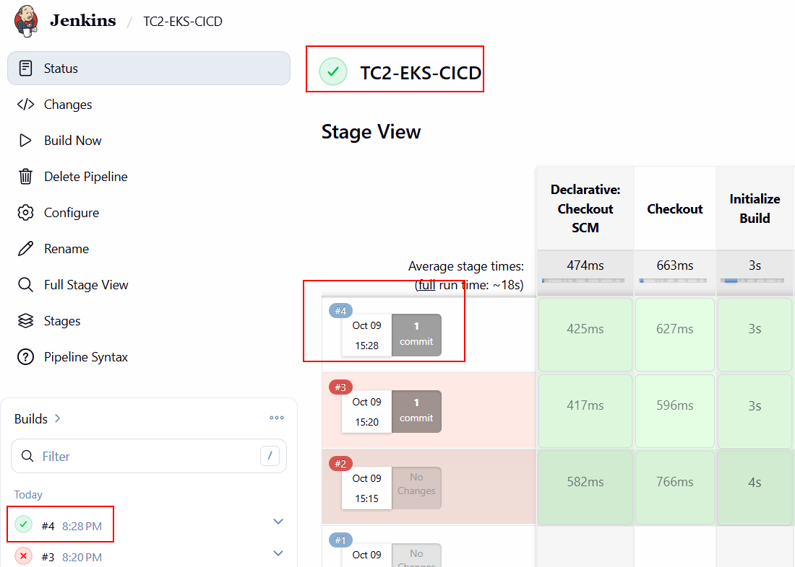

Now, see we verified the pipeline works manually, we need to automate this process. We'll create a webhook in our GitHub repo that points to our Jenkins server. 

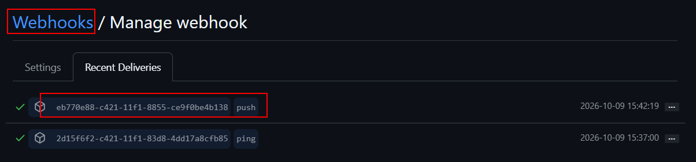

I edited my pipeline to point to my repo and extract the Jenkinsfile that incldes all of my pipeline stages after the GitHub webhook reaches out to the Jenkins server. 

Jenkins then runs the Jenkinsfile pipeline itself. You should see the same pipeline automatically triggered and become successful after you've created this process. 

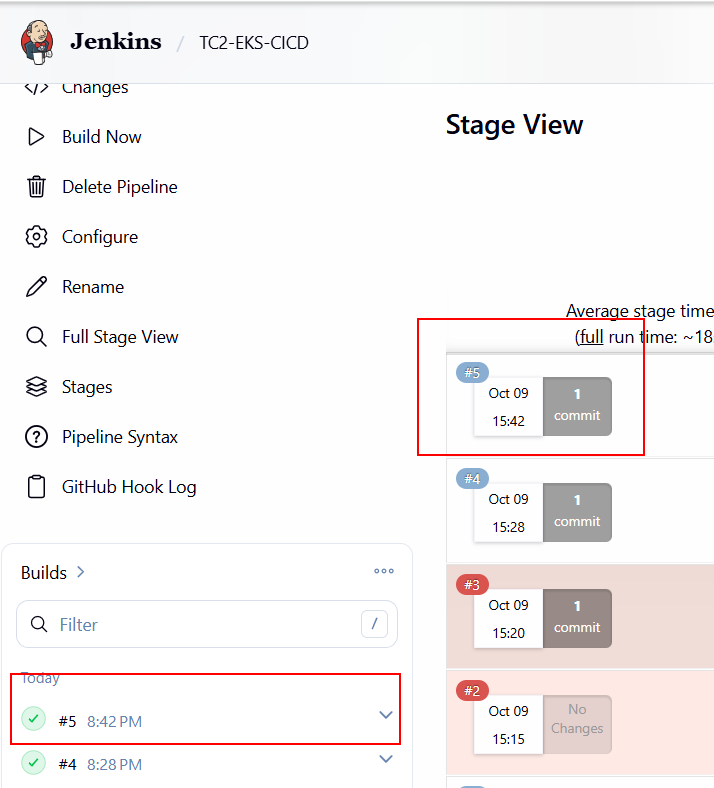

Lets see if our application was actually deployed. You should see the Python Flask app in your AWS endpoint URL. 

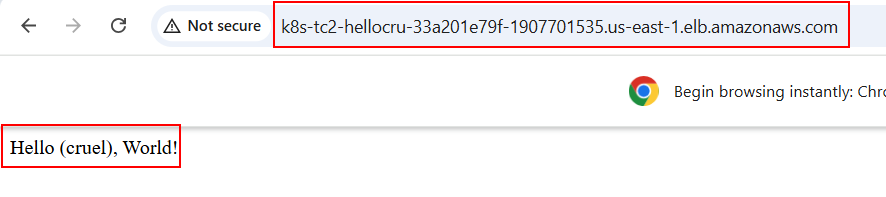

Essentially, we're done with the project. We've shown from end to end that we created an automated CI/CD pipeline that will deploy our application based on any changes we make to our GitHub repo. This is true DevOps Engineering workflows. 

Now that we can deploy our application, lets make sure it's highly available (HA) using a load test for scaling. 

## Phase 6: HPA and Node Autoscaler Load Tests

There are two separate tests we need to conduct here. We need to make sure the Pods scale up when the loads on the containers increase. Our minimum replica set is 1 and our maximum is 3 or 4 I believe. I made a custom siege test from our last TC so we'll reuse that with the appropriate AWS endpoint URL. You can run the test in a separate terminal and watch the pods scale up and down in the original terminal using `kubectl top pods`. Make sure to include your right namespace. You can see below that after the stress test, the pods scaled from 1 to 3. We had a low CPU threshold of 15% which allowed them to scale to easily. 

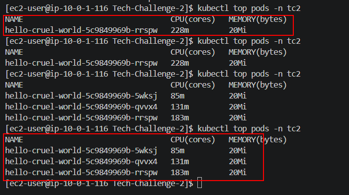

Lets test the cluster autoscaler. Remember, this test has nothing to do with utilization. It's all based on hardware requests. So we needed to create a separate deployment of pods within our K8s environment that would demonstrate if a pod deployment (with multiple Pods) requested high resource limits, the deployment will go into a Pending status before deploying more nodes to handle all of the pods. So we should see the Pending status eventually turn into a Running state but also see our nodes scale up from 1. 

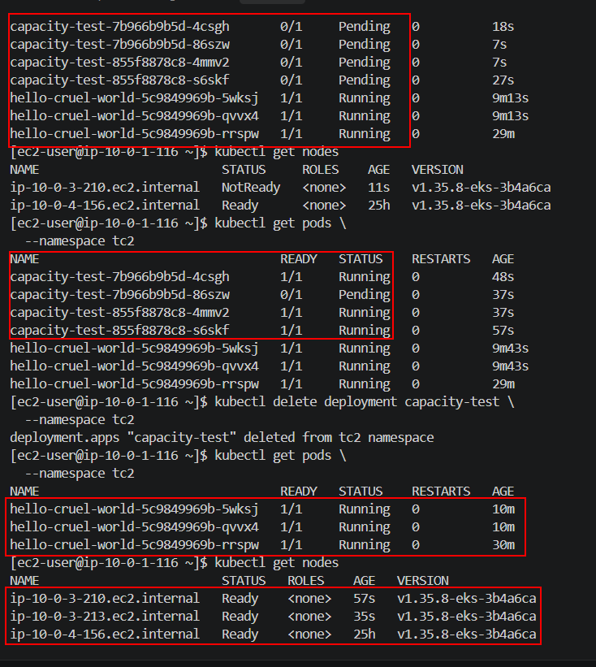

This demonstrates our application can handle a stress test. Beautiful. For the last phase, we'll use GitHub Actions and Argo CD instead of Jenkins. 

## Phase 7: GitOps with GitHub Actions and ArgoCD

Final phase time! Okay, what is Argo CD? It's a tool we can use to make sure our K8s environment always matches the state defined in our GitHub repo. It makes the GitHub repo our source of truth. If our environment doesn't match, either Argo CD will show out of sync or we can make Argo CD automatically sync the environment to match GitHub. Basically we can always have the desired state be consistent without having to manually do this. 

Lets start by creating a separate namespace for Argo CD and installing a separate K8s deployment for it. Make sure to disable your Jenkins pipeline also. 

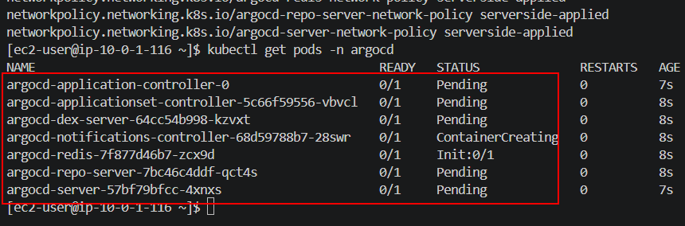

Argo CD supplies you with a command to receive the initial password for the dashboard. Then, use `kubectl` to create a port fowarding on your EC2 instance to accecss the dashboard. 

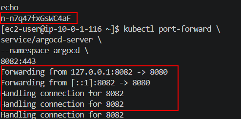

Get logged into the dashboard. How cool, right?

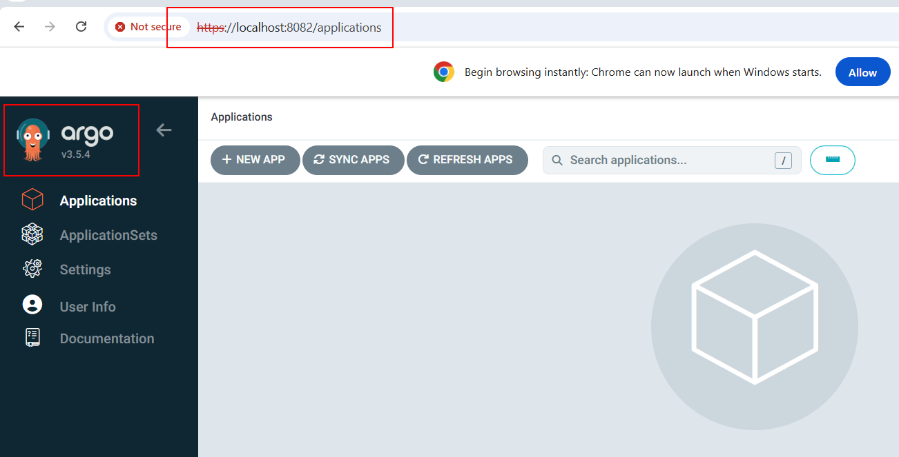

Lets move back over to our values.yaml file on our EC2 instance and make sure the current deployment's image tag matches our values.yaml file. Once you get the tag, put the new tag in the values.yaml. Push this file to your GitHub account. The image tag shouldn't be updated since that was one of the tasks in our Jenkins pipeline. We need the image to match what we push to our repo because Argo CD will check for the image tag and if it's not correct, it will show out of sync. 

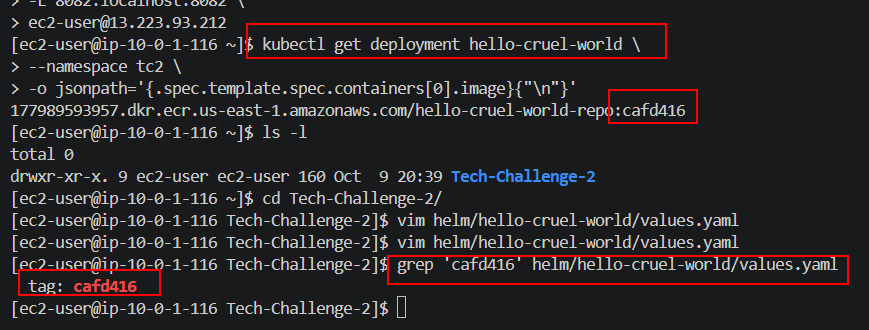

In the Argo CD dashboard, choose `+ New` so we can create our application. Lets make everything congruent. Give it the name hello-cruel-world with the project name being default and the sync policy being manual. We'll change it to automatic once we make sure it works properly. 

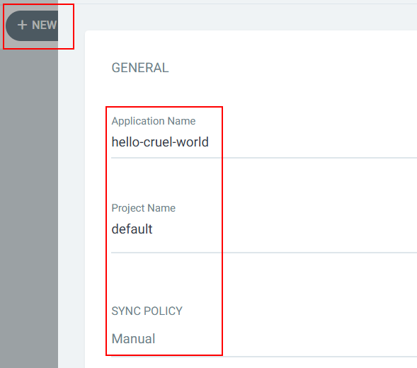

Point Argo CD to our repo so it will know the source of truth. We're working on the main branch (although we should've switch to the GitOps branch) and then give it the path to the helm chart it should be monitoring. 

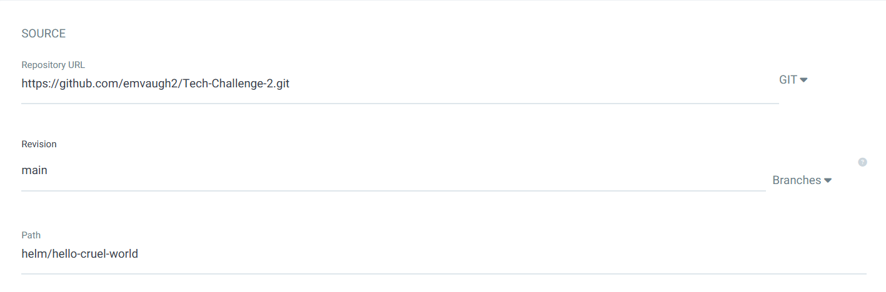

I believe it automatically filled in the Cluster URL but I gave it the namespace since all of our files belong in the tc2 namespace. 

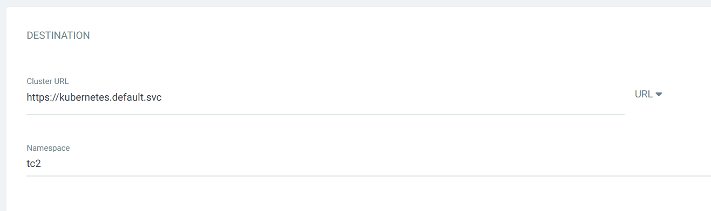

If everything goes to plan, you'll see that the application is deployed, healthy and in sync. 

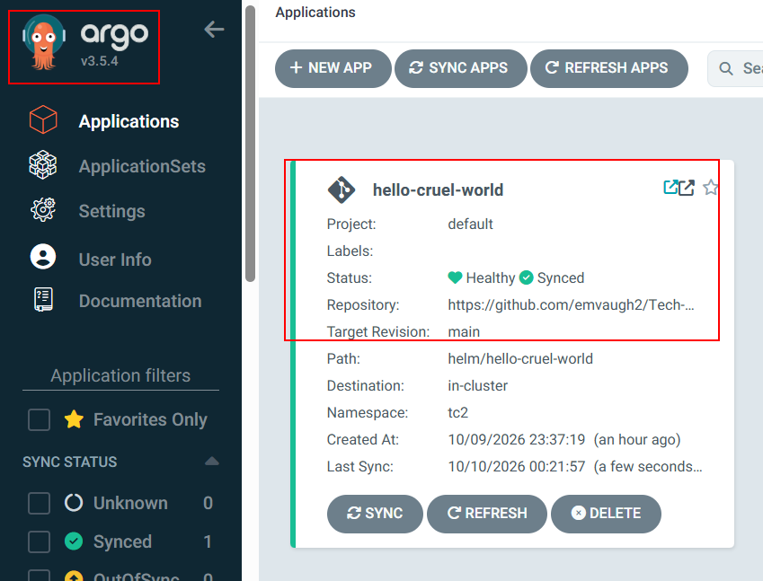

You can also check this in your EC2 instance using the `kubectl get deployment -n argocd` command. 

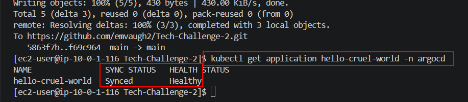

Lets run a quick curl test to double check that our application is running on our AWS endpoint. 

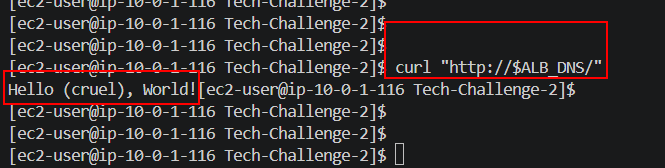

Lets manually check to make sure Argo CD is detecting changes in our environment. Our initial test didn't work properly. Since we have autoscaling defined in 3 places (in the values.yaml, hpa.yaml, and Cluster Autoscaler), our replicas didn't actually scale up. Argo CD detected the changes but didn't change the cluster state. We opted for a more simple test that didnt affect anything. We added an annotation to to our deployment.yaml file and pushed it to the repo. Argo CD detected this and showed `OutOfSync`. 

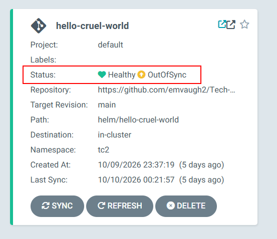

If you click on details and go to the deployment object in Argo CD, you can use the Diff tab to show what's different between the current deployment and the current configuration in your repo. It picked up on the annotation line. 

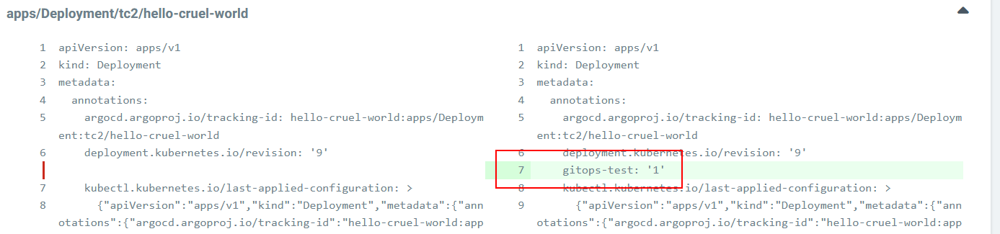

Here's the magic of Argo CD. To make sure our current configuration matches our source of truth, click on the Sync button on our application in Argo CD and watch the application resync. Argo CD will push these new configs to the deployment. 

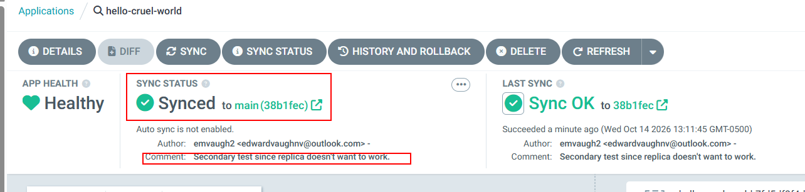

Go back to our EC2 instance and check our deployment for the new annotation line. Remember, we only pushed this line to our GitHub repo. We never updated our actual deployment with it. Argo CD will do that part. With a grep command on `kubectl get deployment`, you'll see the annotation line has been added! Very nice.

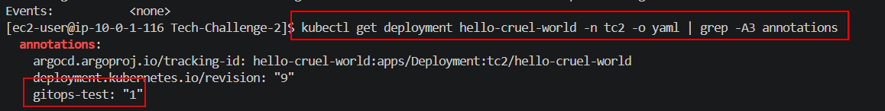

Lets automate this process. Go to your Argo CD application and change the sync policy to Enable Auto-Sync. Self heal is optional. I chose both. 

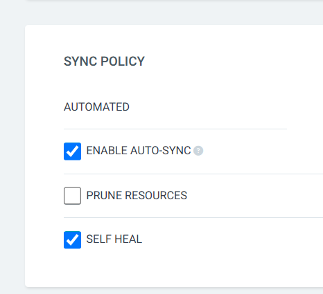

Now, lets create the GitHub Actions side of this. I had Copilot generate the gitops.yaml file for me. Honestly I need more practice making these things from scratch. As far as the configuration is concerned, go to your local cloned repo and create the `.github` directory and then a `workflows` directory. Put yout `gitops.yaml` file here. GitHub will automatically pick up on this workflow once you make another push to your repo. 

I forgot to mention we needed to create a few repository secrets and variables to allow our gitops.yaml file to function. We didn't want to hardcode these values in our file because the file will be publicly accessible. I dont think we created any tokens for this either. 

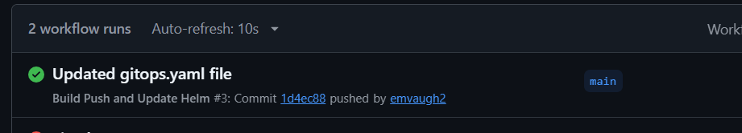

Lets do our last bit of validation verifications. First, when you do the push to your remote repo, retrieve the SHA value. This is what will appear for our image tag. 

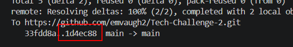

When you go back to the application in Argo CD, the image should automatically be updated with this new tag to match the currently environment. 

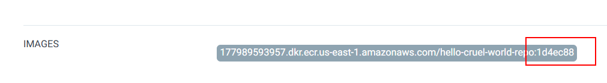

Since Argo CD updates the live environment, it will push this new tag to the deployment when you can check using `kubectl get deployment` or something similiar.

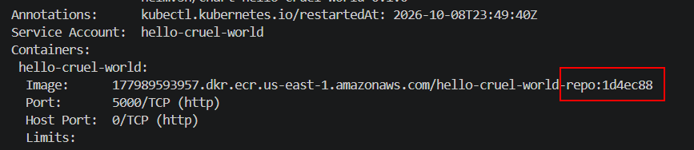

The final verification check is making sure our application still works after everything is said and done. Get your service endpoint using `kubectl get svc` and put it in your web browser

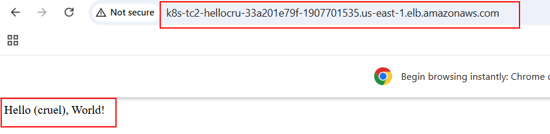

Congratulations! You finished TC2! We learned a lot here as well. It wasn't as tedious as TC1 but it was a growing experience to use Argo CD. 

Catch us in TC3!